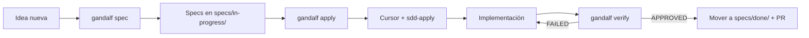

# 🧙 Gandalf

> **You shall pass… directly from idea to production-ready code.**

**Gandalf** es un CLI local que ordena tus pedidos de desarrollo siguiendo la metodología **Spec Driven Development (SDD)**. Convierte cualquier idea —una app nueva desde cero o una feature dentro de tu proyecto actual— en una serie de specs claros, accionables y verificables, antes de escribir una sola línea de código.

Pensado para integrarse con **Cursor**, **Git** y los stacks más usados (`Next.js`, `Flutter`, `FastAPI`, `Python`, `genérico`).

---

## 📌 ¿Qué es esto?

Gandalf es un **constructor de specs SDD**. Su trabajo es **ordenar el pedido** antes de programar:

- 🧱 **App nueva desde cero** → `gandalf init` crea estructura de carpetas, reglas de Cursor y el primer flujo SDD listo para arrancar.
- 🧩 **Feature dentro de un proyecto existente** *(recomendado)* → `gandalf spec` detecta tu stack, te hace las preguntas correctas y genera los 4 archivos de spec en una rama nueva de git.

> ¿Por qué SDD? Porque las features mal especificadas son la principal fuente de bugs, retrabajo y deuda técnica. Gandalf te obliga a pensar antes de codear, sin fricción.

---

## 🔮 ¿Qué es Spec Driven Development?

SDD propone que **cada feature pase primero por 4 documentos vivos**, antes de tocar código:

| # | Archivo | Pregunta que responde |
|---|---|---|
| 1 | `01_proposal.md` | **¿Qué queremos lograr y por qué?** Contexto, objetivo, in/out of scope. |
| 2 | `02_requirements.md` | **¿Cómo sabremos que está hecho?** Criterios de aceptación (Given / When / Then). |
| 3 | `03_design.md` | **¿Cómo lo vamos a construir?** Arquitectura, contratos, decisiones técnicas. |
| 4 | `04_tasks.md` | **¿Cuál es el plan paso a paso?** Tareas atómicas, ordenadas, marcables. |

Estos documentos viven en tu repo (`specs/in-progress/{feature-slug}/`) y se mueven a `specs/done/` cuando la feature pasa `gandalf verify`.

---

## ⚡ Instalación

```bash
git clone https://github.com/sebacaro/gandalf.git
cd gandalf
bash scripts/install.sh
```

El instalador:

1. Crea un `venv` aislado.
2. Instala dependencias (`typer`, `rich`, `questionary`, `jinja2`, `pyyaml`).
3. Registra el comando global `gandalf` en `/usr/local/bin` o `~/.local/bin`.

Verifica con:

```bash
gandalf --help
```

---

## 🚀 Uso

### 1. Iniciar un proyecto nuevo

```bash
gandalf init
```

Crea estructura de carpetas según el stack elegido + `.cursor/rules/` con las reglas SDD + carpeta `specs/in-progress/`.

### 2. Especificar una feature *(flujo recomendado)*

```bash
cd mi-proyecto
gandalf spec
```

- Detecta el stack automáticamente (`pubspec.yaml`, `next.config.js`, `requirements.txt`, etc.).
- Te guía con un formulario interactivo (`questionary`).
- Genera `specs/in-progress/{slug}/{01..04}.md`.
- Crea la rama `feature/{slug}` en git.

### 3. Abrir los specs en Cursor

```bash
gandalf apply
```

Abre los 4 archivos en Cursor para que ejecutes el comando `sdd-apply` y dejes que la IA implemente siguiendo los specs.

### 4. Verificar la implementación

```bash
gandalf verify
```

Recorre los criterios de aceptación de `02_requirements.md`, te pide marcar cada uno (`✅ cumplido`, `⚠️ parcial`, `❌ faltante`) y muestra un resumen. Cuando todo está aprobado, mueves la feature a `specs/done/` y abrís el PR.

---

## 🧠 Stacks soportados

| Stack | Detección | Templates específicos |
|---|---|---|
| **Next.js** | `next.config.*`, `app/`, `pages/` | ✅ |
| **Flutter** | `pubspec.yaml`, `lib/` | ✅ |
| **FastAPI** | `requirements.txt` con `fastapi` | ✅ |
| **Python** | `pyproject.toml`, `requirements.txt` | ✅ |
| **Genérico** | Fallback para cualquier proyecto | ✅ |

> Agregar un stack nuevo toma menos de 10 minutos: ver [Agregar un nuevo stack](#-agregar-un-nuevo-stack).

---

## 🏛️ Arquitectura

Gandalf está construido con **Clean Architecture** y separación estricta de responsabilidades:

```
gandalf/
├── main.py                              # Entry point
├── src/
│   ├── domain/                          # Entidades + interfaces (cero deps)
│   │   ├── entities/                    # FeatureSpec, Project
│   │   └── services/                    # Interfaces de StackDetector, SpecGenerator
│   ├── application/use_cases/           # Lógica de cada comando
│   │   ├── create_feature_spec.py
│   │   ├── init_project.py
│   │   ├── apply_spec.py
│   │   └── verify_spec.py
│   ├── infrastructure/
│   │   ├── detectors/                   # Auto-detección de stack
│   │   ├── generators/                  # Renderizado con Jinja2
│   │   ├── templates/{stack}/           # 4 templates .j2 por stack
│   │   ├── cursor/                      # Integración con Cursor
│   │   └── git/                         # Operaciones git (branch, etc.)
│   └── presentation/
│       ├── cli/commands/                # Comandos typer (spec, init, apply, verify)
│       ├── forms/                       # Formularios interactivos (questionary)
│       └── ui/display.py                # Componentes visuales (rich)
```

Principios aplicados:

- **SOLID** en todos los módulos.
- **Domain** no conoce a `typer`, `rich` ni a Jinja2.
- **Dependency Inversion** entre capas (interfaces en `domain/services/`).
- Funciones pequeñas, nombres descriptivos, sin lógica en la vista.

---

## 🧪 Tests rápidos

```bash
# Smoke test
python main.py --help

# Detección de stack
python -c "from src.infrastructure.detectors.file_stack_detector import FileStackDetector; print(FileStackDetector().detect('.'))"

# Generación end-to-end
python -c "
from src.domain.entities.feature_spec import FeatureSpec
from src.application.use_cases.create_feature_spec import create_feature_spec
spec = FeatureSpec(
    name='Test', slug='test', stack='generic',
    description='Test feature', context='Test context',
    new_components='TestComponent', modified_files='main.py',
    acceptance_criteria=['Given user / When action / Then result'],
    edge_cases='Empty state', project_path='/tmp/gandalf_test',
)
ok, files, err, _ = create_feature_spec(spec)
print('OK', files) if ok else print('ERROR', err)
"
```

---

## ➕ Agregar un nuevo stack

1. Crear carpeta `src/infrastructure/templates/{stack}/` con los 4 templates `.j2`.
2. Agregar entrada en el dict `STACKS` de `file_stack_detector.py`.
3. Agregar la lógica de detección en `FileStackDetector.detect()`.
4. Registrar los directorios del proyecto en `JinjaSpecGenerator._get_project_dirs()`.

---

## 🗺️ Flujo recomendado de día a día



---

## 🤝 Contribuir

Pull requests bienvenidas. Antes de enviar:

1. Sigue los principios de **Clean Architecture** y **SOLID** ya establecidos.
2. Funciones pequeñas y con docstring describiendo *qué hace*, *parámetros* y *retorno*.
3. No mezcles lógica en la presentación.
4. Agrega templates `.j2` si introduces un stack nuevo.

---

## 📜 Licencia

MIT © [sebacaro](https://github.com/sebacaro)

---

## ✨ Filosofía

> *"All we have to decide is what to do with the spec that is given us."* — Gandalf, probably.

**Ordená el pedido. Después codeá.**
